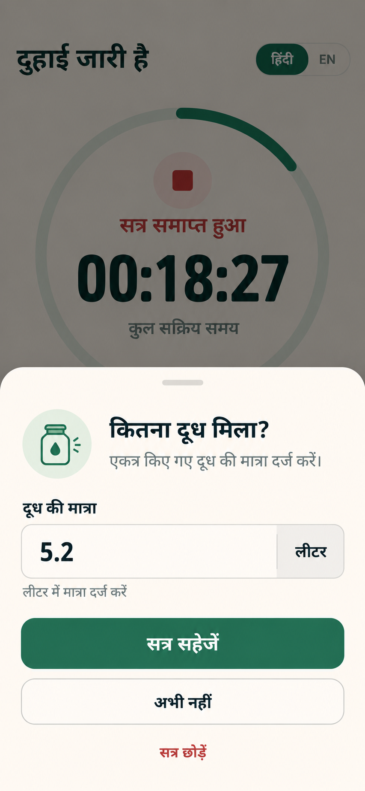
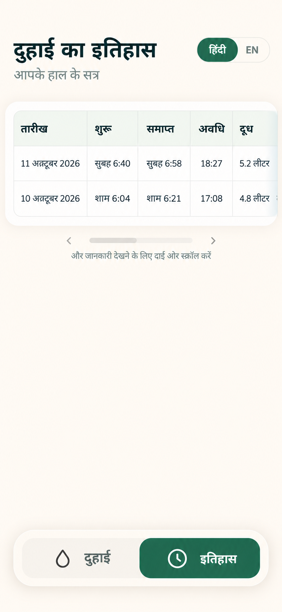

# Milking Tracker with Music 🎵🐄

A mobile-first full-stack web application designed for dairy farmers to track milking sessions with calming music to promote stress-free cattle environments and improve milk yield.

Built with Next.js, React, Tailwind CSS, shadcn/ui, Motion, Node.js, Express, and MongoDB.

> 🚀 **Live Demo**: [https://milking-tracker-web.onrender.com](https://milking-tracker-web.onrender.com)  
> 📡 **Live API**: [https://milking-tracker-api-o5c3.onrender.com](https://milking-tracker-api-o5c3.onrender.com)  
> 🩺 **Health Check**: [https://milking-tracker-api-o5c3.onrender.com/health](https://milking-tracker-api-o5c3.onrender.com/health)

---

## 📱 Screenshots & User Experience

| 1. Idle Home Screen | 2. Active Session Timer |
| :---: | :---: |
|  |  |

| 3. Milk Quantity Entry | 4. Session History |
| :---: | :---: |
|  |  |

---

## 🌟 Features

- **Drift-Free Milking Timer**: High-precision active timer derived from timestamps, resilient to browser background-tab throttling.
- **Calming Music Integration**: Automatically starts relaxing soothing music (`Moon-Waltz.mp3`) on session start, synchronized with the timer.
- **Synchronized Controls**: Single-tap Start, Pause, Resume, and Stop controls that coordinate both music playback and elapsed time.
- **Honest Audio Fallback**: Resilient autoplay handling with an explicit `Retry Music` option if browser restrictions delay audio, without stopping or resetting the timer.
- **Milk Quantity Logging**: Modal entry prompting for milk collected in litres after stopping, with input validation (positive finite numbers) and draft retention upon network retry.
- **Real History View**: Session history displayed in a responsive table (Date, Start Time, End Time, Duration, Milk Collected) fetched directly from MongoDB via the Express API.
- **Bilingual Interface**: Full support for **Hindi (हिन्दी)** and **English**, remembering the user's preference without disrupting active sessions or resetting timers.
- **Floating Bottom Navigation**: Smooth thumb-reach navigation with animated active tab indicator powered by Motion (`motion/react`).

---

## 🏗️ Architecture & Technology Stack

| Layer | Technologies | Responsibilities |
| --- | --- | --- |
| **Frontend** | Next.js (App Router), TypeScript, Tailwind CSS v4, shadcn/ui, Motion (`motion/react`) | Mobile-first UI, HTML5 audio engine, drift-free session state machine, bilingual i18n |
| **Backend** | Node.js (ESM), Express, Mongoose, Zod, Helmet, CORS | RESTful API (`POST /sessions`, `GET /sessions`, `GET /health`), validation, error handling |
| **Database** | MongoDB (`milking_sessions` collection) | Durable persistence of completed milking sessions |

---

## 🚀 Getting Started

### Prerequisites

- **Node.js** v20.x or newer
- **npm** v10.x or newer
- **MongoDB** instance (Local MongoDB or free [MongoDB Atlas](https://www.mongodb.com/cloud/atlas) cluster)

---

### 1. Backend Setup

1. Open a terminal and navigate to the `backend` folder:
   ```bash
   cd backend
   ```

2. Install dependencies:
   ```bash
   npm install
   ```

3. Create your `.env` configuration from `.env.example`:
   ```bash
   cp .env.example .env
   ```

   Ensure your `.env` contains:
   ```dotenv
   NODE_ENV=development
   PORT=9041
   MONGO_URI=mongodb://127.0.0.1:27017/milking_tracker
   CLIENT_ORIGIN=http://localhost:9040
   ```
   *(If using MongoDB Atlas, replace `MONGO_URI` with your connection string: `mongodb+srv://<user>:<password>@cluster.mongodb.net/milking_tracker`)*

4. Start the backend development server:
   ```bash
   npm run dev
   ```

   The backend will start at `http://localhost:9041`. You can verify health at `http://localhost:9041/health`.

---

### 2. Frontend Setup

1. Open a second terminal and navigate to the `frontend` folder:
   ```bash
   cd frontend
   ```

2. Install dependencies:
   ```bash
   npm install
   ```

3. Configure environment variables:
   ```bash
   cp .env.example .env.local
   ```

   Default configuration in `frontend/.env.local`:
   ```dotenv
   PORT=9040
   NEXT_PUBLIC_API_BASE_URL=http://localhost:9041
   ```

4. Start the frontend development server:
   ```bash
   npm run dev
   ```

5. Open [http://localhost:9040](http://localhost:9040) on your mobile device or browser.

---

## 📡 API Contract

### 1. `POST /sessions`
Save a completed milking session.

**Request Body:**
```json
{
  "start_time": "2026-10-11T08:00:00.000Z",
  "end_time": "2026-10-11T08:15:00.000Z",
  "duration": 900,
  "milk_quantity": 8.5
}
```

**Response (`201 Created`):**
```json
{
  "id": "6708bf93...",
  "start_time": "2026-10-11T08:00:00.000Z",
  "end_time": "2026-10-11T08:15:00.000Z",
  "duration": 900,
  "milk_quantity": 8.5,
  "createdAt": "2026-10-11T08:15:02.000Z",
  "updatedAt": "2026-10-11T08:15:02.000Z"
}
```

### 2. `GET /sessions`
Retrieve all persisted milking sessions, sorted newest first (`start_time` descending).

**Response (`200 OK`):**
```json
[
  {
    "id": "6708bf93...",
    "start_time": "2026-10-11T08:00:00.000Z",
    "end_time": "2026-10-11T08:15:00.000Z",
    "duration": 900,
    "milk_quantity": 8.5,
    "createdAt": "2026-10-11T08:15:02.000Z",
    "updatedAt": "2026-10-11T08:15:02.000Z"
  }
]
```

### 3. `GET /health`
Operational readiness health check.

**Response (`200 OK`):**
```json
{
  "status": "ok"
}
```

---

## 🧪 Testing & Verification

### Run Backend Tests
From the `backend` directory:
```bash
npm test
```
Runs the built-in Node.js test runner covering schema validation, negative numbers, duration calculations, 404 handling, malformed JSON bodies, and health endpoints.

### Run Frontend Typecheck & Build
From the `frontend` directory:
```bash
npm run typecheck
npm run build
```
Validates strict TypeScript types and verifies production bundle compilation.

---

## ☁️ Deployment Guide (Render - All-in-One)

Both the Next.js frontend and Express backend can be deployed together for free on [Render](https://render.com) from this single repository using the included [`render.yaml`](render.yaml) Blueprint or manually through the dashboard.

### 🌐 Live Deployment Links
- **Frontend App**: `https://milking-tracker-web.onrender.com`
- **Backend API**: `https://milking-tracker-api-o5c3.onrender.com`
- **API Health Check**: `https://milking-tracker-api-o5c3.onrender.com/health`
